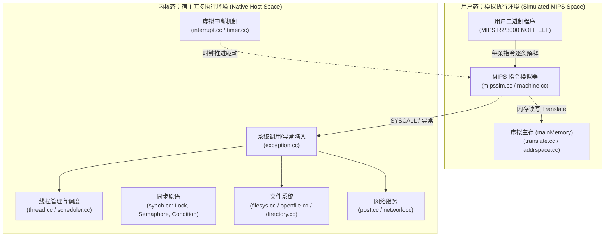
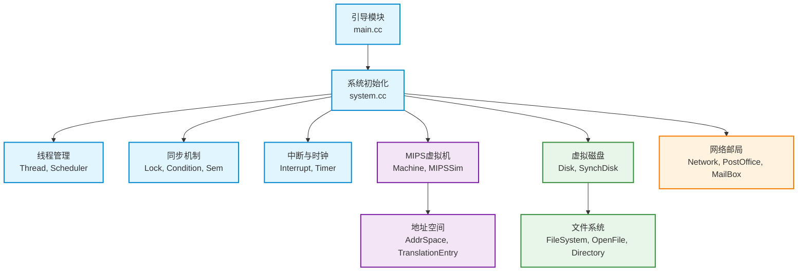

# Nachos 系统架构与设计全景

本文档系统性剖析 Nachos 3.4 操作系统的架构体系、核心运行机制以及经过现代 C++17 重构后的关键工程设计，旨在帮助学习者深入掌握操作系统内核的精髓。

---

## 1. 系统核心设计哲学：双层执行模型 (Dual Execution Model)

Nachos 最独特、最具教学启发性的设计是其**双层执行架构**：



1. **用户程序（User Mode）**：
   - 运行由 MIPS 交叉编译器编译出的 **MIPS R2/3000 机器码**。
   - 用户指令由 Nachos 宿主进程中的 `mipssim.cc` 逐条译码模拟执行，所有的寄存器和虚拟内存访问（`mainMemory`）均受到受控监控。
   - 当用户程序执行 `syscall` 指令时，模拟器捕获指令并调用内核 `RaiseException(SyscallException, ...)`。
2. **内核服务（System Mode）**：
   - Nachos 内核本身（线程、调度器、文件系统、设备驱动）**直接编译为宿主机（如 macOS ARM64 / Linux x86_64）的原生机器码执行**。
   - 内核代码享有宿主机 C++17 的完整执行性能与丰富的现代语言特性（RAII、智能指针、标准容器）。

---

## 2. 核心子系统架构全景



---

## 3. 关键子系统机制剖析

### 3.1 线程生命周期与上下文切换

```mermaid
stateDiagram-v2
    [*] --> JUST_CREATED: new Thread()
    JUST_CREATED --> READY: Thread::Fork()
    READY --> RUNNING: Scheduler::Run()
    RUNNING --> READY: Thread::Yield() / 时钟中断
    RUNNING --> BLOCKED: Thread::Sleep() (等待锁/信号量/I/O)
    BLOCKED --> READY: Semaphore::V() / Lock::Release()
    RUNNING --> [*]: Thread::Finish()
```

- **状态机模型**：线程具备 `JUST_CREATED`, `RUNNING`, `READY`, `BLOCKED` 4 种生命周期状态。
- **上下文切换（Context Switch）**：
  - 经典 Nachos 使用架构相关的底层汇编（`switch.s`）。
  - 在现代 macOS ARM64 移植中，采用符合 POSIX 规范的标准用户级上下文协程接口（`ucontext.h` / `switch_arm64.cc`），完全规避了手写 ARM64 寄存器压栈容易被 Clang PAC（指针身份验证）拦截的问题。
- **线程栈越界防护**：
  - 每个线程分配固定大小栈（`StackSize = 4 * 1024` 字），并在栈底设置魔法哨兵 `STACK_FENCEPOST = 0xdeadbeef`，每次调度切入与检查时自动校验。

### 3.2 离散事件驱动的中断机制 (Simulated Interrupts)

Nachos 是一个运行在单进程内的伪并发系统。硬件设备（时钟、磁盘、控制台、网络）都是通过事件队列模拟的：

- **时钟前进模型**：时钟并不按真实物理时间自增，而是由内核操作或用户指令执行推进（`stats->totalTicks`）。
- **待处理中断队列（`PendingInterruptList`）**：
  - 设备发起异步操作后，向中断系统注册未来触发的定时事件（如磁盘寻道耗时 500 ticks）。
  - 中断管理器使用 `std::unique_ptr<List>` 管理所有按触发时间排序的待处理事件。
  - 每当执行一条指令或显式调用 `interrupt->OneTick()`，检查队列头是否有到期的事件，若有则调用其 ISR（中断服务例程）。

### 3.3 虚拟内存与分页映射

Nachos 模拟器包含 `mainMemory` 线性数组，大小为 `NumPhysPages * PageSize`（默认 32 页 × 128 字节 = 4KB）：

```mermaid
flowchart LR
    VirtAddr["虚拟地址 (16/32-bit)\n[VPN 虚拟页号 | Offset 页内偏移]"]
    VPN["VPN"] --> Lookup{"映射模式"}
    Lookup -->|页表模式 (tlb == nullptr)| PT["线性页表 TranslationEntry[]\n(addrspace.h)"]
    Lookup -->|TLB模式 (USE_TLB)| TLB["TLB 快速缓存 (16项)\n(machine.h)"]
    PT --> PPN["PPN 物理页号"]
    TLB -->|命中| PPN
    TLB -->|未命中| PageFault["PageFaultException\n(由内核填充TLB)"]
    PPN --> PhysAddr["物理地址\nPPN * PageSize + Offset"]
    PhysAddr --> MainMem["物理内存数组\nmachine->mainMemory"]
```

---

## 4. 现代 C++17 重构与教学特性

在本次重构中，Nachos 被注入了工业级现代 C++17 特性，为现代系统编程树立规范：

| 机制 | 原生 Nachos 3.4 | 现代 C++17 Nachos | 教学意义 |
| :--- | :--- | :--- | :--- |
| **资源所有权** | 手动 `new` / `delete`，析构多处内存泄露 | `std::unique_ptr` 全面 RAII 管理 | 引导学生建立资源生命周期确定性理念 |
| **临界区加锁** | 手动调用 `Acquire()` / `Release()`，易忘释放 | `LockGuard guard(lock);` 作用域守卫 | 杜绝由于提前 return 或异常引发的死锁 |
| **并发锁滥用检测** | 无保护，`Lock` 甚至为空桩代码 | 4 维主动检测（自我死锁、越权释放、持锁析构等） | 教学实训时精准拦截学生容易踩的同步坑 |
| **结构化日志** | 晦涩的 `DEBUG('t', ...)` 宏，单字母标签 | `LOG_INFO`, `LOG_WARN` 带时钟/线程上下文与 ANSI 颜色 | 极大提升复杂多线程时序的调试可视性 |
| **自动化测试** | 无测试运行器，仅手动输入参数 | 纯 Python 一键运行 `test_runner.py`（自动化评分） | 开箱即用支持学生自测与 CI 自动评分 |

---

## 5. 源码目录导航

- [`code/threads/`](file:///Users/darion.yaphet/source/nachos-3.4/code/threads/)：内核线程、上下文切换、优先级调度、同步原语（Lock, Condition, Semaphore）。
- [`code/userprog/`](file:///Users/darion.yaphet/source/nachos-3.4/code/userprog/)：进程地址空间（`AddrSpace`）、位图分配器（`BitMap`）、系统调用异常分发（`exception.cc`）。
- [`code/vm/`](file:///Users/darion.yaphet/source/nachos-3.4/code/vm/)：软件充填 TLB 虚拟内存扩展。
- [`code/filesys/`](file:///Users/darion.yaphet/source/nachos-3.4/code/filesys/)：模拟物理磁盘（`SynchDisk`）、文件头（`FileHeader`）、目录管理与文件读写。
- [`code/machine/`](file:///Users/darion.yaphet/source/nachos-3.4/code/machine/)：MIPS 硬件与外设模拟（指令解码、中断、时钟、控制台）。
- [`code/network/`](file:///Users/darion.yaphet/source/nachos-3.4/code/network/)：模拟可靠与不可靠网络通信（`PostOffice` 邮局系统）。
- [`code/bin/`](file:///Users/darion.yaphet/source/nachos-3.4/code/bin/)：二进制工具（`coff2noff` 转换器）。
