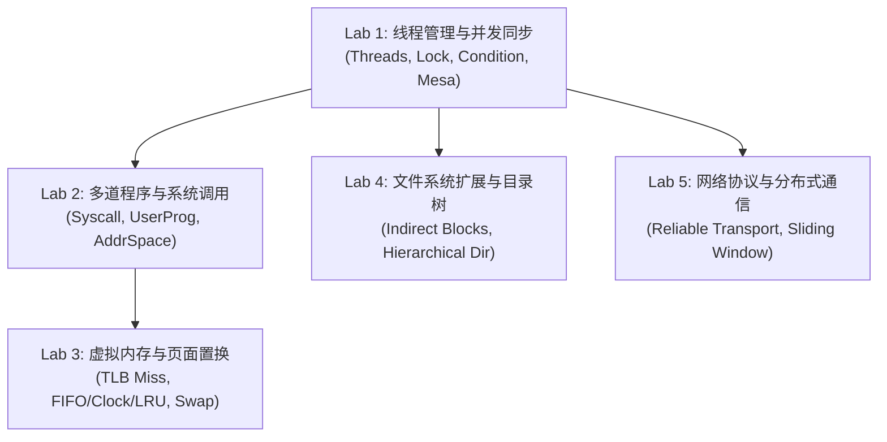

# Nachos 操作系统实验指南与课程中心

欢迎来到 Nachos 3.4 现代操作系统实验课程！本指南为计算机系本科生与操作系统研习者量身定制，涵盖理论剖析、代码实现指引、调试秘籍与自动化评测体系。

---

## 🗺️ 实验依赖关系与学习路线图



- **第一阶段（必修基础）**：
  - [**Lab 1: 线程管理与并发同步**](file:///Users/darion.yaphet/source/nachos-3.4/docs/labs/lab1_threads.md)
- **第二阶段（体系分支）**：
  - [**Lab 2: 多道程序与系统调用**](file:///Users/darion.yaphet/source/nachos-3.4/docs/labs/lab2_userprog.md)
  - [**Lab 4: 文件系统扩展与目录树**](file:///Users/darion.yaphet/source/nachos-3.4/docs/labs/lab4_filesys.md)
  - [**Lab 5: 网络通信与可靠传输协议**](file:///Users/darion.yaphet/source/nachos-3.4/docs/labs/lab5_network.md)
- **第三阶段（深度进阶）**：
  - [**Lab 3: 虚拟内存与页面置换**](file:///Users/darion.yaphet/source/nachos-3.4/docs/labs/lab3_vm.md)（依赖 Lab 2）

---

## 📚 体系文档索引

1. [**Nachos 架构全景与设计指南 (ARCHITECTURE.md)**](file:///Users/darion.yaphet/source/nachos-3.4/docs/ARCHITECTURE.md)：
   - 深入理解双层执行模型（用户态 MIPS 模拟器与内核态宿主机器码）；
   - 中断事件驱动时钟模型与寄存器级上下文切换机制；
   - 现代 C++17 重构模式（RAII、智能指针、死锁拦截器）。
2. [**Lab 1: 线程管理与并发同步**](file:///Users/darion.yaphet/source/nachos-3.4/docs/labs/lab1_threads.md)
3. [**Lab 2: 多道程序与系统调用**](file:///Users/darion.yaphet/source/nachos-3.4/docs/labs/lab2_userprog.md)
4. [**Lab 3: 虚拟内存与页面置换**](file:///Users/darion.yaphet/source/nachos-3.4/docs/labs/lab3_vm.md)
5. [**Lab 4: 文件系统扩展与目录树**](file:///Users/darion.yaphet/source/nachos-3.4/docs/labs/lab4_filesys.md)
6. [**Lab 5: 网络通信与可靠传输协议**](file:///Users/darion.yaphet/source/nachos-3.4/docs/labs/lab5_network.md)

---

## ⚡ 快速开始与自动化评测

### 1. 编译全套内核
```bash
# 进入代码目录编译所有实验目标
make -C code clean
make -C code
```

### 2. 运行自动化测试套件
```bash
# 一键运行全部实验的自动化回归评测
code/test_runner.py

# 针对指定实验模块运行测试并输出详细日志
code/test_runner.py --filter threads --verbose
```

### 3. 启用现代结构化调试日志
Nachos 内置带时钟、线程名和 ANSI 色彩的结构化日志系统：
- `-d t`：追踪线程调度与切换
- `-d s`：追踪互斥锁加锁、等待与释放
- `-d m`：追踪 MIPS 虚拟机单步指令执行
- `-d a`：追踪虚拟内存与地址映射翻译
- `-d f`：追踪文件系统操作
- `-d +`：启用所有调试输出

示例：
```bash
./code/threads/nachos -d ts
```

---

## 📝 实验提交自查清单 (Student Checklist)

每次完成 Lab 提交前，请务必执行以下自查：
- [ ] **0 编译警告**：编译器开启 `-Wall -Wshadow -std=c++17` 时无任何警告。
- [ ] **内存安全**：没有悬垂指针，所有动态对象均由 `std::unique_ptr` 或明确的所有权生命周期管理。
- [ ] **无死锁与锁滥用**：加锁必须与解锁严格配对，推荐优先使用 `LockGuard` RAII 守卫。
- [ ] **通过自动化回归测试**：运行 `code/test_runner.py` 实现 100% 测试通过率。
