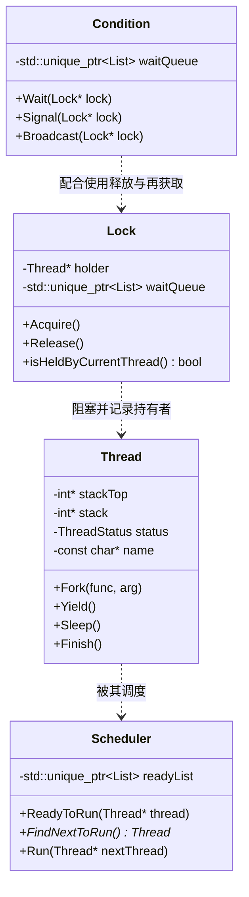

# Lab 1: 线程管理与并发同步 (Threads & Synchronization)

---

## 1. 实验目标与理论背景

在现代操作系统中，**线程（Thread）** 是 CPU 调度的基本单位，而**并发同步（Concurrency & Synchronization）** 是操作系统保证多任务安全访问共享资源的基石。

完成本实验后，你将能够：
1. 深入理解操作系统内核级线程的创建、上下文切换与销毁过程。
2. 掌握关中断（Interrupt Disabling）实现底层原子性的方法与局限性。
3. 熟练运用与实现互斥锁（`Lock`）与条件变量（`Condition`，Mesa 语义）。
4. 解决经典的进程同步问题（生产者-消费者、读者-写者、餐哲问题）。
5. （进阶）实现线程回收机制（`Thread::Join`）与抢占式优先级调度器（Priority Scheduler）。

---

## 2. 核心源码导读



| 文件 | 路径 | 核心职责 |
| :--- | :--- | :--- |
| `thread.h / .cc` | `code/threads/` | 线程控制块（TCB）、栈分配、`Fork`、`Yield`、`Sleep`、`Finish` |
| `scheduler.h / .cc` | `code/threads/` | 就绪队列管理（`readyList`）、线程切换派发（`Run`） |
| `synch.h / .cc` | `code/threads/` | 信号量（`Semaphore`）、互斥锁（`Lock`）、条件变量（`Condition`）、`LockGuard` |
| `threadtest.cc` | `code/threads/` | 实验测试驱动入口与用例集 |
| `switch_arm64.cc / switch.s` | `code/threads/` | 底层机器级寄存器保存与恢复（上下文切换） |

---

## 3. 实验任务清单

### 任务 1：掌握互斥锁与条件变量实现（Mesa 语义）

在 Nachos 中，条件变量遵循 **Mesa 语义**：
- 当 `Signal()` 唤醒一个等待线程时，该线程被移入 `readyList`，但**并不立即抢占 CPU 或获得锁**。
- 因此，当被唤醒的线程实际运行时，条件可能已经再次变为不满足。
- **规范实践**：`Wait()` 必须被包裹在 `while` 循环中，而不是 `if` 语句：
  ```cpp
  while (bufferCount == 0) {
      notEmpty.Wait(&lock);
  }
  ```

检查点：
- [ ] 确保 `Lock::Acquire()` 在锁已被持有时，将当前线程放入等待队列并调用 `currentThread->Sleep()`。
- [ ] 确保 `Lock::Release()` 唤醒等待线程，且严格检查当前释放者必须是持有者（防止越权释放）。
- [ ] 确保 `Condition::Wait()` 原子地释放锁、休眠并重新获取锁。
- [ ] 确保 `Condition::Signal()` 与 `Broadcast()` 仅唤醒相应等待队列中的线程。

### 任务 2：实现经典的读者-写者问题（Readers-Writers Problem）

设计并实现一个读者优先（Reader-Preference）或无饥饿（Fair）的读写锁类 `RwLock`：
```cpp
class RwLock {
  public:
    explicit RwLock(const char* debugName);
    void AcquireRead();
    void ReleaseRead();
    void AcquireWrite();
    void ReleaseWrite();
  private:
    Lock lock;
    Condition readCond;
    Condition writeCond;
    int activeReaders{0};
    int waitingWriters{0};
    bool activeWriter{false};
};
```
编写测试驱动：模拟 5 个读者线程与 2 个写者线程并发操作共享数据，验证没有写写冲突，且读读并发允许。

### 任务 3（进阶挑战）：实现 `Thread::Join()` 与退出状态回收

Nachos 原生模型中，主线程退出时若子线程仍在执行，缺少优雅等待机制。
当前基座已提供 `int Thread::Join()`：对已 `Fork()` 的 joinable 线程允许一个
内核调用者等待，返回退出码并删除目标线程；返回后目标指针失效，不可再次调用。
未启动线程和并发的第二个等待者会触发断言。下面的父子资格校验、可重复查询
退出码等语义属于扩展任务，需要先调整对象回收与句柄设计。

1. 在 `Thread` 中引入父子等待关系与退出码状态。
2. 扩展 `int Thread::Join()`：
   - 调用者阻塞等待目标线程执行 `Finish()`。
   - 目标线程结束时唤醒等待者并清理自身堆栈。
   - 考虑处理：多次 Join、非父进程 Join、线程尚未启动或已经结束的情况。

### 任务 4（进阶挑战）：抢占式优先级调度（Priority Scheduling）

1. 为 `Thread` 增加 `int priority`（0~63，数值越大优先级越高）。
2. 将 `readyList` 由普通 FIFO 链表改造为**优先队列（SortedList）**。
3. **抢占（Preemption）**：当新就绪线程的优先级高于当前运行线程时，立即触发 `currentThread->Yield()` 产生抢占。
4. **优先级反转（Priority Inversion）与优先级捐赠（Priority Donation）**：
   - 当低优先级线程持有高优先级线程所需的锁时，将低优先级线程临时提升到等待者的最高优先级，防止中等优先级线程饿死高优先级线程。

---

## 4. 调试与自动化测试

### 4.1 启用结构化跟踪日志
```bash
# 跟踪线程调度过程
./threads/nachos -d t

# 跟踪同步锁与条件变量生命周期
./threads/nachos -d s

# 联合跟踪
./threads/nachos -d ts
```

### 4.2 运行自动化评测
在 `code/` 目录下执行自动化测试套件：
```bash
./test_runner.py --filter threads --verbose
```
确保全套测试用例全部输出 `[PASS]`。
