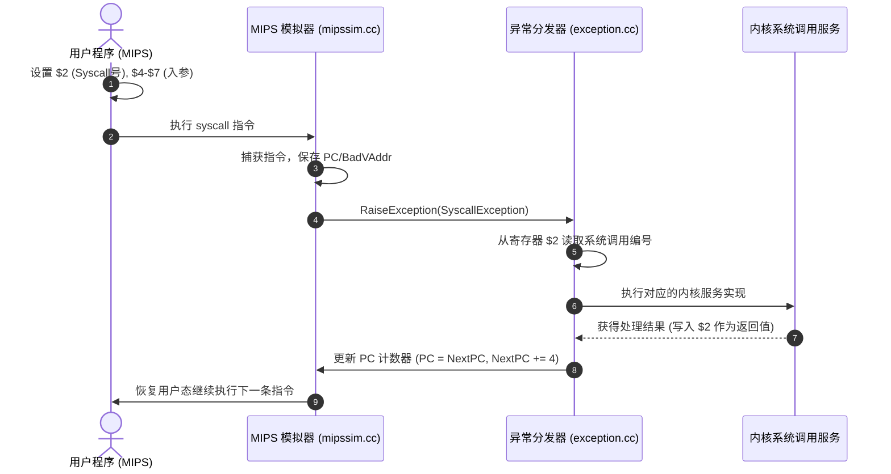

# Lab 2: 多道程序设计与系统调用 (Multiprogramming & Syscalls)

---

## 1. 实验目标与理论背景

在完成内核级线程后，操作系统的下一步核心使命是**支持用户程序运行与地址空间隔离**。用户程序运行在非特权模式下，不能直接访问物理硬件或内核数据，必须通过**系统调用（System Call）**陷入（Trap）内核来请求服务。

完成本实验后，你将能够：
1. 掌握用户程序二进制可执行文件（NOFF 格式）的加载与内存布局。
2. 深刻理解硬件虚拟化、特权级切换（User Mode vs System Mode）与异常中断机制。
3. 熟悉 MIPS ABI 体系架构的系统调用调用约定（Calling Conventions）。
4. 实现多道用户程序并发执行（Multiprogramming）与物理页框位图分配管理。
5. 设计并实现核心系统调用（`Exec`, `Exit`, `Join`, `Create`, `Open`, `Read`, `Write`, `Close`）。

---

## 2. 系统调用机制与 MIPS ABI 规范

当 MIPS 用户程序执行 `syscall` 指令时，模拟器将触发 `SyscallException`，并把控制权转移到 `code/userprog/exception.cc` 的 `ExceptionHandler(ExceptionType which)`。



### MIPS 寄存器约定说明：
- **`$2` (r2, `v0`)**：输入时存放系统调用编号（如 `SC_Halt`, `SC_Exit`, `SC_Exec` 等，定义在 `code/userprog/syscall.h`）；返回时存放系统调用的**返回值**。
- **`$4` ~ `$7` (r4~r7, `a0`~`a3`)**：依次存放第 1 到第 4 个入参。
- **PC 推进规则（必须执行！）**：
  由于 `syscall` 是一条指令，陷入内核后若不推进程序计数器，从异常返回用户态时将**重新执行同一条 `syscall` 指令导致死循环**：
  ```cpp
  registers[PrevPCReg] = registers[PCReg];
  registers[PCReg] = registers[NextPCReg];
  registers[NextPCReg] = registers[NextPCReg] + 4;
  ```

---

## 3. 实验任务清单

### 任务 1：安全的用户空间内存拷贝机制 (Safe Memory Copy)

用户程序传递给内核的指针是**虚拟地址（Virtual Address）**，且用户传递的指针可能非法（越界、指向内核区、未映射页）。内核绝不能直接解引用用户指针！

在 `code/userprog/` 中设计一组安全的内存读取/写入工具函数：
```cpp
// 从用户空间安全读取字符串 (如文件名)，直至遇到 '\0' 或达到最大长度
bool CopyStringFromUser(int userVirtAddr, char* kernelBuf, int maxLen);

// 从用户虚拟地址读取指定字节数至内核缓冲区
bool CopyFromUser(int userVirtAddr, char* kernelBuf, int byteCount);

// 将内核缓冲区数据安全写入用户虚拟地址空间
bool CopyToUser(const char* kernelBuf, int userVirtAddr, int byteCount);
```
当前 `UserMem` 辅助函数通过 `machine->Translate()` 检查每个字节的页表或 TLB
映射，访问失败返回 `false`，不会进入用户态异常处理器。失败前可能已拷贝一段
前缀；字符串缓冲区在容量为正时会保留结尾 NUL。缺页与 TLB miss 也返回
`false`，辅助函数不会主动填充 TLB。用户指令的驻留页 TLB miss 已可由异常处理器
充填并重试；内核拷贝的重试策略和非驻留页调入由后续虚拟内存实验实现。

加载器会验证 NOFF 头、实际文件长度、段范围及重叠，并在完整读入临时映像后
写入模拟内存。通过 `AddrSpace::IsValid()` / `GetLoadError()` 检查结果，非法
映像不会覆盖原内存。空段和 BSS 的未使用文件偏移保留旧转换工具兼容性。

### 任务 2：支持多道程序物理页框分配 (Page Allocator)

原生 Nachos 的 `AddrSpace` 假设所有程序均被加载到物理内存从 0 开始的连续页中，这导致**系统同时只能加载运行一个程序**。
1. 使用 `code/userprog/bitmap.h` 中的 `BitMap` 维护全局物理页框分配表：
   ```cpp
   BitMap pageBitmap(NumPhysPages); // 跟踪哪些物理页已被占用
   ```
2. 在 `AddrSpace::AddrSpace(OpenFile *executable)` 中：
   - 动态向 `pageBitmap` 申请可用的物理页号（`physicalPage = pageBitmap.Find()`）。
   - 将程序代码段与数据段逐页拷贝到对应的物理页中，不再假设物理页连续。
   - 内存不足时妥善处理错误并释放已分配页。
3. 在 `AddrSpace::~AddrSpace()` 析构时：
   - 归还该进程占用的所有物理页框（`pageBitmap.Clear(entry.physicalPage)`）。

### 任务 3：实现核心系统调用

进程表已提供原子创建与稳定句柄，可作为系统调用实现的基础：

```cpp
auto& manager = ProcessManager::Instance();
auto parent = manager.CreateProcess();
auto child = manager.CreateProcess(parent);
auto retained = manager.GetProcess(child->GetPid());
ASSERT(child->Exit(7));
int status = 0;
ASSERT(child->Wait(parent, &status) == ProcessWaitResult::Exited);
ASSERT(manager.RemoveProcess(child));
ASSERT(retained->Wait(parent, &status) == ProcessWaitResult::Exited);
```

查询句柄在移出进程表后仍有效；移除必须匹配原对象，避免 PID 复用后旧句柄误删
新进程。父子等待也按父进程对象身份校验，不能用相同的数字 PID 代替父句柄。
退出状态首次写入后不再改变，当前等待者全部唤醒，之后可重复查询。绑定线程使用
`SetThreadHandle()`，地址空间由 `Process::SetSpace()` 与
`Thread::SetAddressSpace()` 共享持有。接入用户态系统调用时，由内核取得真实
调用者对应的父进程句柄，不能信任用户程序传入的身份。

当前地址空间仍采用 `physicalPage = virtualPage`，只支持单个驻留用户映像；
进程表和稳定句柄不替代上一个任务中的物理页框隔离。

在 `code/userprog/exception.cc` 中实现系统调用分发与处理：

1. **`Exit(int status)`**：
   - 用户程序正常或异常退出。
   - 释放地址空间资源，设置退出状态码，唤醒等待该进程的父进程。
2. **`Exec(char *name)`**：
   - 读取用户文件名，打开可执行文件，创建新的 `AddrSpace` 与新 `Thread`。
   - 为新线程分配用户栈并调用 `Fork()` 执行。
   - 返回分配的进程 ID（`SpaceId`）。
3. **`Join(SpaceId id)`**：
   - 阻塞当前进程，直至目标进程调用 `Exit()`，返回其退出状态码。
4. **控制台 I/O 系统调用 (`Read` / `Write`)**：
   - 当 `fd == ConsoleInput` 时，从控制台读取输入字符。
   - 当 `fd == ConsoleOutput` 时，将用户缓冲区字符输出到控制台。

---

## 4. 调试与自动化测试

### 4.1 运行测试用例
```bash
# 启动用户程序模拟子系统
./userprog/nachos

# 带地址转换与指令调试运行
./userprog/nachos -d am
```

### 4.2 运行自动化测试套件
```bash
./test_runner.py --filter userprog --verbose
```
确保用户态初始引导与停机全部输出 `[PASS]`。
