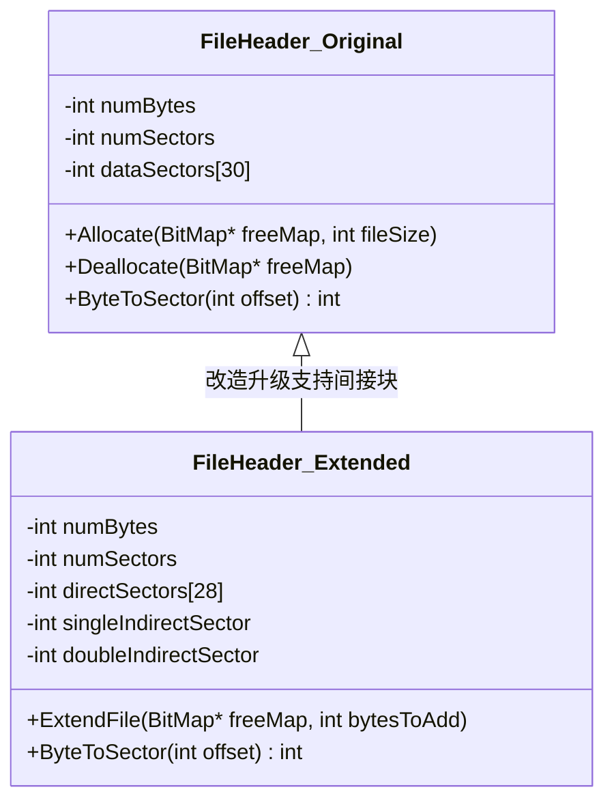

# Lab 4: 文件系统扩展与目录树 (File System Extensions)

---

## 1. 实验目标与理论背景

文件系统是操作系统负责管理持久化存储介质（如磁盘、SSD）的核心软件层，它将物理扇区（Sectors）抽象为具有人类可读命名、层次结构和访问权限的**文件（File）**与**目录（Directory）**。

### 原生 Nachos 文件系统的两大经典局限：
1. **文件大小固定且极小**：
   - 依赖直接索引块（Direct Indexing）。一个 `FileHeader` 占用一个物理扇区（128 字节），除去头部元数据，仅能容纳 30 个扇区指针（`NumDirect = 30`）。
   - **最大文件大小仅为 30 × 128 = 3840 字节（≈ 3.75 KB）**，且创建文件时必须预分配全部扇区，不支持追加动态增长。
2. **目录仅支持单级平铺**：
   - 全局仅有一个根目录文件，最多容纳 10 个文件表项，不支持子目录（无 `/dir1/subfile` 层级路径）。

完成本实验后，你将能够：
1. 掌握基于索引节点（Inode / FileHeader）的文件空间分配与管理机理。
2. 突破文件尺寸限制，实现间接索引块（Indirect Blocks）与动态分配扩展。
3. 实现层次化多级目录树（Hierarchical Tree Directory）与路径解析。
4. 保证多线程并发读写文件时的一致性与互斥同步。

---

## 2. 文件系统磁盘布局演进



### 间接块寻址容量测算：
- 扇区大小 = 128 字节，一个扇区可存放 $128 / 4 = 32$ 个扇区指针。
- 28 个直接块：$28 \times 128 = 3584$ 字节
- 1 个一级间接块：$32 \times 128 = 4096$ 字节
- 1 个二级间接块：$32 \times 32 \times 128 = 131072$ 字节 (128 KB)
- **扩展后最大文件容量突破 138 KB**，满足课程用户程序与复杂数据持久化需求！

---

## 3. 实验任务清单

### 任务 1：支持文件动态自动增长 (Dynamic File Growth)

1. 在原生 Nachos 中，当 `OpenFile::WriteAt` 写入超出当前文件长度的数据时，会直接忽略或截断。
2. 改造 `FileHeader` 与 `OpenFile`：
   - 检查 `position + numBytes > fileHeader->FileLength()`。
   - 若超出，向 `freeMap` 申请新的物理扇区，并将新扇区号记录至索引结构中。
   - 动态更新文件的实际字节大小并写回磁盘扇区。

### 任务 2：实现一级与二级间接索引块 (Indirect Indexing)

1. 重构 `code/filesys/filehdr.h`：
   ```cpp
   constexpr int NumDirect = 28; // 28 个直接索引块

   class FileHeader {
     private:
       int numBytes{0};
       int numSectors{0};
       int direct[NumDirect]{};
       int singleIndirect{0};       // 指向包含 32 个扇区号的扇区
       int doubleIndirect{0};       // 指向二级索引扇区
   };
   ```
2. 改造 `ByteToSector(int offset)` 寻址函数：
   - 若 `sectorIndex < NumDirect`，直接返回 `direct[sectorIndex]`；
   - 若在单重间接块范围内，从 `singleIndirect` 扇区读入索引数组，索引对应项；
   - 若在双重间接块范围内，执行二级扇区查找。
3. 确保文件被删除时，递归释放所有索引块扇区与数据扇区。

### 任务 3：实现层次多级目录树 (Hierarchical Directory Tree)

1. 改造 `DirectoryEntry`：
   - 增加目录标记：`bool isDirectory;`。
2. 编写路径解析器（Path Traversal）：
   - 解析例如 `/usr/bin/test` 的绝对路径与相对路径。
   - 从根目录开始，依次查找子目录，逐层打开其 `OpenFile` 并检索下一级。
3. 支持创建子目录：
   ```cpp
   bool CreateDirectory(const char* path);
   ```
4. 递归删除目录：
   - 支持删除空目录，或级联删除非空目录及其包含的所有文件。

### 任务 4：文件系统并发同步安全

原生文件系统没有对同一文件的并发打开和写入进行互斥控制。
1. 在 `code/filesys/filesys.cc` 中维护全局系统打开文件表（System Open File Table）：
   - 记录每个活跃文件的 Inode 扇区号、打开计数器（Reference Count）以及专属的 `Lock` 或 `RwLock`。
2. 确保多个线程同时读取同一文件时互不干扰，写入时排他执行。

---

## 4. 调试与自动化测试

```bash
# 格式化虚拟磁盘并列出文件系统元数据
./filesys/nachos -f -D

# 运行自动化测试套件
./test_runner.py --filter filesys --verbose
```
确保虚拟磁盘格式化、位图分配与目录读写全部验证通过。
