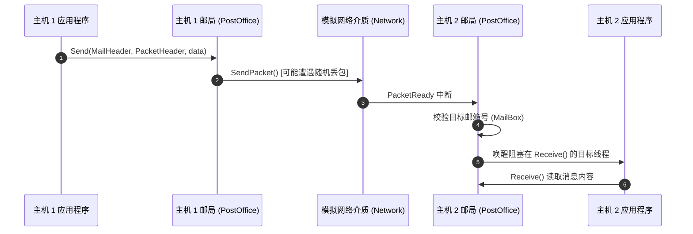

# Lab 5: 网络通信与可靠传输协议 (Networking & Distributed Systems)

---

## 1. 实验目标与理论背景

现代计算系统绝非孤岛，操作系统必须提供跨机器通信的网络协议栈。Nachos 在 `code/network/` 下模拟了多台主机组成的局域网环境，并提供物理链路层丢包与网络延迟的模拟特性。

完成本实验后，你将能够：
1. 理解物理信道与链路层的不可靠特性（丢包、乱序、重复帧）。
2. 在不可靠数据报上设计并实现**端到端可靠传输协议（Reliable Transport Protocol）**。
3. 掌握滑动窗口（Sliding Window）、序号确认（ACK）、超时重传（Retransmission Timer）的核心机理。
4. （进阶）实现分布式互斥锁（Distributed Lock）与简易远程过程调用（RPC）。

---

## 2. 邮局系统 (PostOffice) 架构模型



- **`Network` 模拟器**：
  - 支持配置丢包率：通过命令行 `./network/nachos -n 0.2` 设置 20% 的丢包概率。
- **`PostOffice` 邮局抽象**：
  - 提供多邮箱分发机制（MailBox），每个邮箱是一个由 `SynchList` 保护的接收队列。

---

## 3. 实验任务清单

### 任务 1：实现停等协议 (Stop-and-Wait Protocol)

在原生数据报之上构建单包可靠传输：
1. 每一包包含单调递增的序列号 `seqNo`。
2. 发送方发送后启动超时定时器等待接收方的 `ACK`。
3. 若超时未收到 `ACK`，重新发送该数据包；接收方过滤重复包并回复 `ACK`。

### 任务 2：实现滑动窗口协议 (Sliding Window Protocol)

为了最大化信道利用率，实现具有流水线发送特性的滑动窗口协议：
1. 维护发送窗口（`SendWindow`）与接收窗口（`ReceiveWindow`）。
2. 支持累积确认（Cumulative ACK）或选择性重传（Selective Repeat）。
3. 动态平滑计算往返时延（RTT）并调整重传超时时间（RTO）。

### 任务 3（进阶挑战）：分布式互斥锁与服务注册

利用可靠消息协议，构建一个分布式协调服务器：
1. 一台 Nachos 实例充当中心协调节点，其他 Nachos 实例作为客户端。
2. 客户端向服务器请求加锁（`AcquireLock`）和释放锁（`ReleaseLock`）。
3. 验证网络延迟或主机乱序情况下的分布式互斥正确性。

---

## 4. 调试与多机联调测试

启动两台相互通信的虚拟 Nachos 节点：
```bash
# 启动第 0 号节点
./network/nachos -m 0 -o 1

# 在另一终端启动第 1 号节点（与其配对通信）
./network/nachos -m 1 -o 0
```
